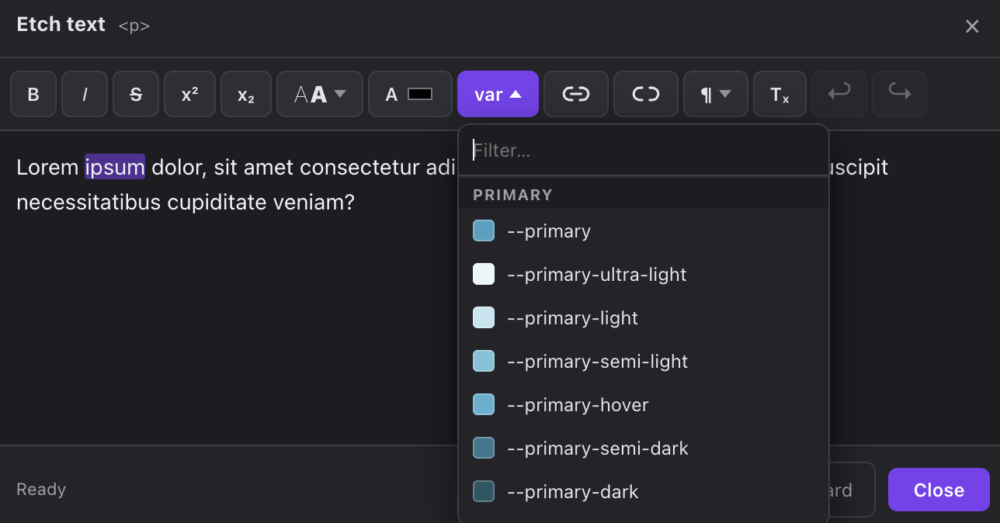

# Etch Text Editor

A WordPress plugin that adds a graphical text-editing popup to the [Etch](https://etchwp.com) builder — for both **Etch text elements** and **Gutenberg text** that lives in Etch as passthrough blocks.

&nbsp;

> Built on top of Etch's experimental Public API (`window.etch`). Etch marks this API as **experimental (0.x)**; breaking changes can occur between Etch releases.

## Why

Out of the box, Etch fully round-trips its own elements to Gutenberg, but text created in Gutenberg only passes *through* to the front end and can't be edited inside Etch. This plugin closes that gap and adds rich inline formatting on top.

## Features

- **Unified popup editor** for:
  - Etch text elements (`p`, `h1`–`h6`, `li`, `blockquote`, `figcaption`)
  - Single Gutenberg passthrough blocks (`core/paragraph`, `core/heading`, `core/preformatted`, `core/verse`)
  - Text blocks nested inside Gutenberg **containers** (`core/group`, `core/columns`, `core/column`, …)
- **Canvas preview**: Gutenberg passthrough placeholders show their real text (with a `GB` badge) instead of an empty `core/*` placeholder.
- **Live preview**: formatting applied in the popup is mirrored into the canvas immediately (visual only; persisted on close).
- **Inline formatting toolbar**: bold (`strong`), italic (`em`), strikethrough (`s`), superscript, subscript, font-weight, text color, links, clear formatting.
- **Color via theme tokens**: pick ACSS / CSS custom-property color tokens (grouped by family) and apply them as `color: var(--token)`.
- **Links**: type a URL or search internal pages, posts and media (WordPress REST API). Placing the caret inside an existing link opens it for editing with the current URL prefilled; removing a link works from the caret too.
- **Extended link options**: edit link title, target and `rel`; links opening in a new tab automatically get `noopener`.
- **Insert menu (¶)**: line break, soft hyphen (`&shy;`) and non-breaking space (`&nbsp;`) at the caret.
- **Paste as plain text**: pasted content from Word/Pages/websites is stripped of all formatting.
- **Clean markup**: multiple inline styles on the same selection are merged into a single ``; empty leftovers are removed; literal ` ` values returned by Gutenberg are automatically converted into real line breaks.
- **Resizable, draggable popup**: drag the header to move it, the bottom-right corner to resize; it opens next to the text you're editing.
- **Toolbar tooltips**: hover over a toolbar button to see what it does; the same hints are available with keyboard focus.
- **Auto-save**: closing saves — via the X, the Close button or a click outside (also `Cmd/Ctrl+Enter`). Discarding is explicit: the **Discard** button or `Esc`.
- **Undo/redo and save safety**: undo or redo local edits with the toolbar or keyboard shortcuts; external changes are detected before overwriting and save errors leave the editor open for retry.
- **Sync-safe editing**: Gutenberg blocks stay core blocks while you edit them normally, so Etch ⇄ Gutenberg two-way sync is preserved. Writes go through `etch.blocks.replace()` + `etch.saveAsync()`.
- **Optional conversion**: standalone Gutenberg `core/paragraph` passthroughs can be converted to native Etch text elements after manual confirmation. Gutenberg paragraphs inside container passthroughs are left untouched.

## How it works

The plugin loads a script into the Etch builder (for logged-in users who can `edit_posts`). It reads block JSON via the public API, renders the editing UI in its own DOM (decoupled from Etch's canvas React tree for robustness), and writes changes back through the public API. Gutenberg passthrough content is edited by rewriting the wrapped block's `innerHTML`/`innerContent`; container blocks are edited by patching only the affected nested block and re-writing the whole passthrough.

## Installation

1. Download the latest release ZIP (or clone this repo and zip the `etch-text-editor` folder).
2. WordPress admin → Plugins → Add New → Upload Plugin → choose the ZIP.
3. Activate.
4. Open a page in the Etch builder. Select a text block (or click a `GB` preview) and use the **✎ Edit** button.

Requirements: WordPress 6.0+, PHP 7.4+, Etch 1.6.x with the Public API enabled.

If you use a page cache (e.g. LiteSpeed), purge it after updating so the builder loads the new script.

## Usage

- Select a text block in the builder → click **✎ Edit** (appears next to the text), or click a `GB` canvas preview. A second click on **✎ Edit** closes the popup again.
- Select some text and format it via the toolbar. Buttons with a caret (▾) open a dropdown — font weight, color tokens (**var**) and the insert menu (**¶**).
- For color, use the native picker or **var** to pick a theme token.
- For links, type a URL or a search term to pick an internal page/post/media item. To change an existing link, place the caret inside it and open the link button — the current URL is prefilled. Use **Options** for title, target and `rel`.
- Use **Cancel** in the link row (or press `Esc`) to leave link editing without closing the popup.
- Pasting always inserts plain text; format it afterwards with the toolbar.
- Use the undo/redo buttons or `Cmd/Ctrl+Z` and `Cmd/Ctrl+Shift+Z` (`Ctrl+Y`) to move through local changes.
- **Saving**: click outside the popup, use the **Close** button or the X, or press `Cmd/Ctrl+Enter`. **Discarding**: the **Discard** button or `Esc`.
- When the text changed elsewhere while the popup was open, choose **Reload latest** or **Keep mine** before saving.
- When a standalone Gutenberg paragraph is detected, choose **Convert to Etch** to turn that block into a native Etch text element, or **Keep as Gutenberg** to leave it unchanged.

## Known limitations

- The Public API is experimental (0.x) — Etch updates may require changes here.
- Double-clicking a paragraph that contains an inline link can crash Etch 1.6.3's own inline editor (`Cannot read properties of undefined (reading 'count')`). This is an Etch bug; the plugin works around it by intercepting the double-click and opening its own editor instead.
- Nested container text is edited in the popup (there is no per-paragraph canvas node inside a container).
- The canvas live-preview writes into Etch's rendered DOM; it is visual only and reconciled on save.

## License

GPL-2.0-or-later. See [LICENSE](LICENSE).
